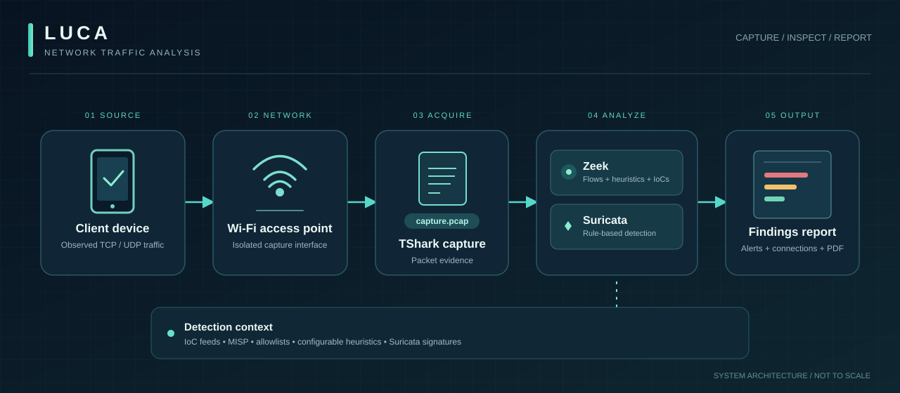

# Luca

**Network traffic capture, indicator matching, and behavioral analysis for devices connected through a monitored Wi-Fi access point.**



Luca observes network communications **without installing an agent on the device being examined**. It captures packets at a dedicated access point, processes them with Zeek and Suricata, and turns the results into structured findings and a PDF report.

The system is intended for authorized network inspection and research. A match or heuristic alert is evidence for investigation, **not proof that a device is compromised**.

## How it works

1. **Connect:** A phone or other Wi-Fi device joins the access point managed by Luca. An upstream interface supplies network connectivity.
2. **Capture:** TShark records TCP and UDP traffic from the configured capture interface to `capture.pcap`.
3. **Analyze:** Zeek extracts connection and protocol metadata; Suricata evaluates rules against the packet capture. The analysis coordinator starts the two engines as separate processes.
4. **Correlate:** Detection logic evaluates observed connections against indicators of compromise (IoCs), configured heuristics, and allowlists.
5. **Report:** Findings are grouped by severity and written alongside connection details and a generated PDF. Capture artifacts can be exported for further analysis.

The high-level data path is:

```text
Device → Luca Wi-Fi AP → TShark → capture.pcap
                                     │
                         ┌───────────┴──────────┐
                         │                      │
                        Zeek                Suricata
                   Protocol metadata       Signature rules
                         │                      │
                         └───────────┬──────────┘
                                     │
                         IoCs + heuristics + allowlists
                                     │
                            Alerts + PDF report
```

## Detection capabilities

| Component | What it examines |
| --- | --- |
| **Zeek** | Connection records, DNS resolutions, HTTP metadata, and TLS/certificate metadata. |
| **Indicator matching** | Configured domains, IP addresses, CIDR ranges, name servers, dynamic-DNS providers, TLDs, and certificate fingerprints, where relevant metadata is available. |
| **Behavioral heuristics** | Protocol/port anomalies, unusual destinations, TLS certificate conditions, and other configurable signals implemented by the analysis engine. |
| **Suricata** | Network signatures stored as Snort-compatible rules plus contextual rules generated for a capture. |
| **Allowlists** | Known permitted hosts, addresses, and ranges used to reduce noisy findings. |

Severity classifications are **High**, **Moderate**, and **Low**. The detection surface depends on what the device transmits, what remains observable through encryption, and the quality of configured intelligence.

## Architecture

| Layer | Implementation | Source |
| --- | --- | --- |
| User interface | Vue 2 capture, network setup, analysis, and report workflow | [`app/frontend/`](app/frontend/) |
| Frontend API | Flask routes for network configuration, capture, analysis, device information, and exports | [`server/frontend/`](server/frontend/) |
| Analysis engine | Python coordinator running Zeek and Suricata against saved PCAPs | [`analysis/`](analysis/) |
| Administration | Vue 2 interface and Flask API for settings, IoCs, allowlists, and MISP integrations | [`app/backend/`](app/backend/), [`server/backend/`](server/backend/) |
| Intelligence storage | SQLite tables for indicators, allowlist entries, and MISP connection settings | [`assets/scheme.sql`](assets/scheme.sql) |
| Feed synchronization | Background loaders for configured IoC/allowlist URLs and MISP instances | [`server/backend/watchers.py`](server/backend/watchers.py) |

### Analysis artifacts

A typical capture is stored in a token-specific directory under `/tmp/`. The pipeline uses or generates:

```text
/tmp/<capture-token>/
├── capture.pcap
└── assets/
    ├── alerts.json
    ├── conns.json
    ├── whitelist.json
    ├── device.json
    ├── capinfos.json
    └── report.pdf
```

The set of files depends on capture progress and whether each analysis stage completed. The frontend also supports exporting the capture directory as a ZIP, including via a removable USB device.

## Installation

**Requirements:** A Debian-family Linux system, root access for installation, an AP-capable Wi-Fi interface for the monitored device, and a separate upstream network interface. The install script provisions host networking and services, so use a **dedicated machine**, not your daily workstation.

```bash
git clone https://github.com/topherchris420/Luca.git
cd Luca
sudo bash install.sh
```

The installer interactively selects interfaces, creates the access-point configuration, installs system dependencies, builds both Vue applications, configures the database and systemd services, and generates a self-signed certificate for administration. Review [`install.sh`](install.sh) before running it: it can modify DNS, hostname, DHCP, network forwarding, and system services.

**Important:** Several installed paths, services, hostnames, and package identifiers still use the upstream **TinyCheck** name. These are implementation details of the current codebase, not separate Luca endpoints.

After installation, the conventional local interfaces are:

| Interface | Address | Purpose |
| --- | --- | --- |
| Capture UI | `http://tinycheck.local` | Configure the monitored connection, run a capture, review findings |
| Administration | `https://tinycheck.local` | Manage configuration, IoCs, allowlists, and integrations |

The administrative HTTPS certificate is self-signed. Hostname resolution and reachability depend on the machine's network configuration.

## Working with captures

Through the capture UI, select or configure the upstream connection, start the access point, connect the device under inspection, record a session, and run the analysis. Review the resulting severity-grouped alerts alongside the observed connections. Export evidence when needed.

The analysis pipeline can also be invoked against an **existing capture directory** containing `capture.pcap` on an installed and configured system:

```bash
python3 /usr/share/tinycheck/analysis/analysis.py /path/to/capture-directory
```

The analyzer expects its dependencies, executable paths, indicator database, and configuration to have been provisioned.

## Configuration and intelligence

The main configuration is [`config.yaml`](config.yaml).

| Setting | Role |
| --- | --- |
| `network.in` / `network.out` | Capture-side and upstream network interfaces |
| `analysis.heuristics` / `analysis.iocs` | Heuristic and indicator-analysis controls |
| `analysis.whitelist` | Enable allowlist handling |
| `analysis.max_alerts` / `analysis.max_ports` | Detection thresholds |
| `frontend.*` / `backend.*` | User-interface behavior and service access |
| `watchers.iocs` / `watchers.whitelists` | External intelligence sources to load |

The administration service supports adding and searching IoCs, adjusting allowlists, and configuring MISP sources. Feed accuracy and freshness affect detection quality. Evaluate external sources before trusting them.

## Technical limitations and operational security

- **Traffic visibility is not endpoint visibility.** Luca examines network evidence; it does not inspect installed apps, local files, or a device's memory.
- **Encryption limits inspection.** Metadata may remain observable, but encrypted application payloads are not automatically decrypted.
- **Heuristics are probabilistic signals.** Benign services can trigger alerts, and malicious traffic can evade available rules and indicators.
- **Captures may contain sensitive data.** Restrict access to PCAPs, exported ZIPs, reports, and the administration interface.
- **The software uses legacy dependencies.** Review and harden the Python, Vue, Node, and system package stack before exposing it beyond a controlled environment. In particular, review remote-access settings and the self-signed administrative certificate.
- **Inspect only devices and networks you own or are authorized to assess.**


Licensed under the **Apache License 2.0**, subject to the included notices.
